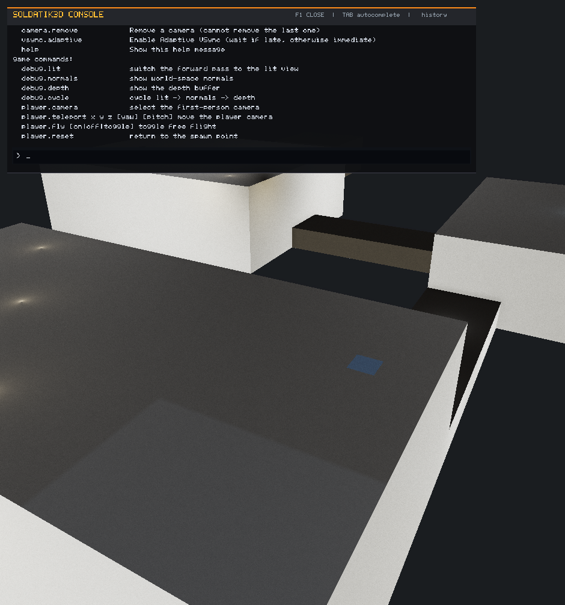
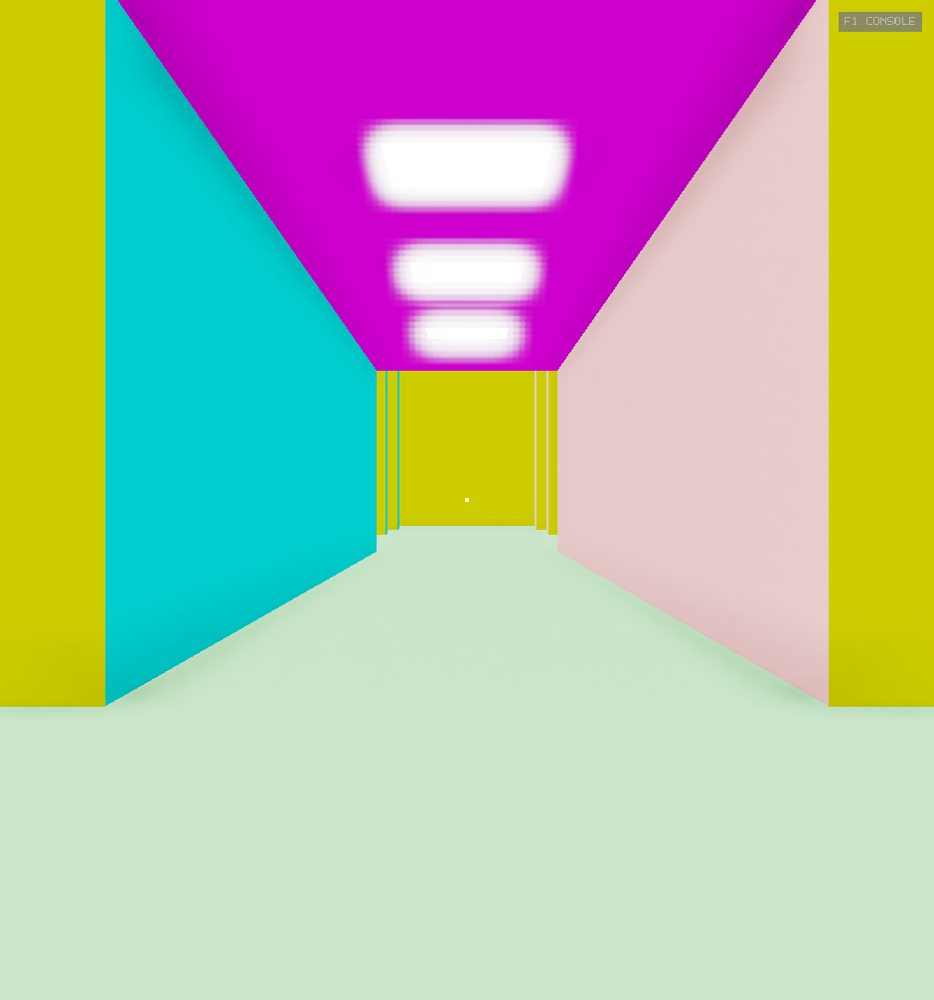
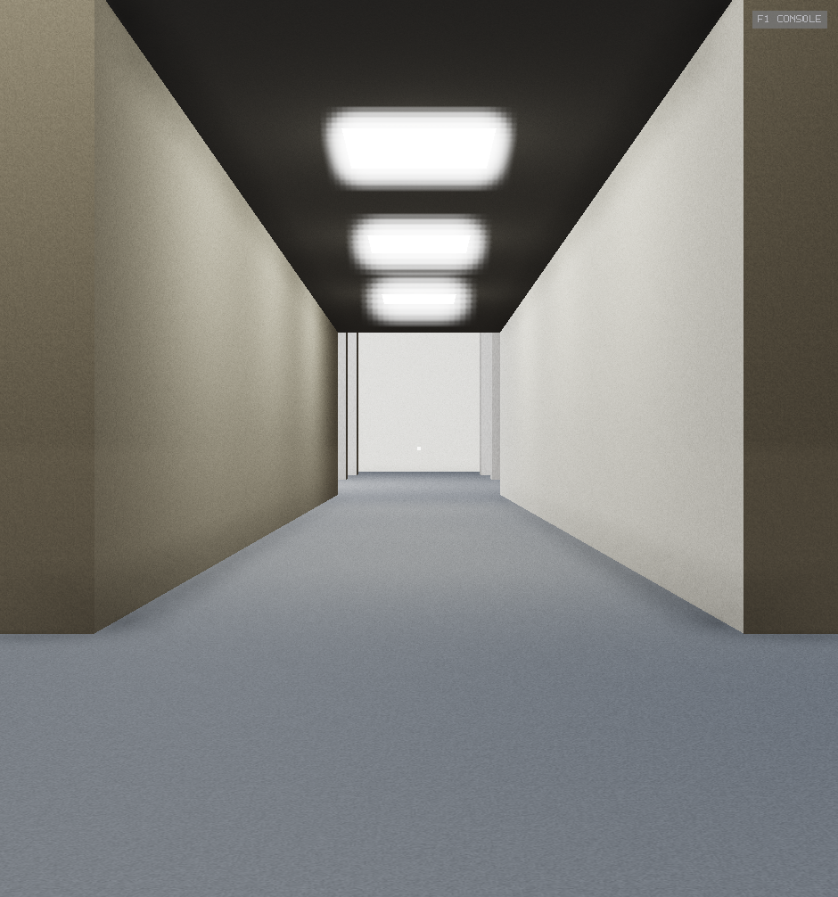

# soldatik3D


**soldatik3D** — a modular 3D game engine in Rust with two production-ready graphics backends: **Vulkan 1.2** and **OpenGL 3.3 core / ES 3.0**. The repository contains the engine and a demonstration game that uses only the public `runtime` API, completely agnostic to the underlying graphics API.

The engine is built from focused crates with single responsibilities: assets, scene & cameras, UI, renderer abstraction, platform abstraction, two graphics backends, and a runtime facade. The demo lives outside `crates/`, keeping `crates/` as pure engine code.

<div align="center">
  <table>
    <tr>
      <td align="center"><strong>Vulkan Gameplay</strong></td>
      <td align="center"><strong>OpenGL Gameplay</strong></td>
    </tr>
    <tr>
      <td></td>
      <td></td>
    </tr>
    <tr>
      <td align="center"><strong>In-Game Console</strong></td>
      <td align="center"><strong>Debug Views</strong></td>
    </tr>
    <tr>
      <td></td>
      <td></td>
    </tr>
  </table>
</div>

---

## Features

- **Dual Graphics Backends** — Vulkan 1.2 (`ash` + `shaderc`) and OpenGL 3.3 core / ES 3.0 (`glutin` + `glow`). Switch via env var or `GameConfig`.
- **Controlled VSync** — `On`, `Off`, `Adaptive`, `Mailbox`; configurable via `GameConfig`, `SOLDATIK3D_VSYNC`, and console commands `vsync.*`. Defaults to `On`; use `SOLDATIK3D_VSYNC=off` for benchmarks.
- **Cross-Platform Builds** — Linux x86_64, Windows x86_64 (MSVC), Android (arm64-v8a / armeabi-v7a) built in GitHub Actions on every push and attached to every GitHub Release/prerelease.
- **Forward PBR Rendering** — Metallic/roughness workflow, IBL from procedural environment cubemap, up to 8 point lights.
- **Shadows** — Orthographic shadow map 2048² with PCF filtering.
- **Post-Processing** — Half-res SSAO, bright-pass bloom with separable Gaussian blur, ACES tone mapping and gamma correction. HDR pipeline uses `R16G16B16A16_SFLOAT`.
- **Frustum Culling** — Camera and light frustum culling for optimal draw calls.
- **Cameras as Engine Citizens** — `World` and `CameraRig` allow spawning named cameras, selecting active, cycling next/prev, and removing them. Runtime always renders through the active camera.
- **Built-In Developer Console** — Command registry, Tab completion, input history, hints, and extensible with game commands. Opens with `F1` or `` ` ``.
- **Immediate-Mode UI** — Built-in bitmap font (uppercase/lowercase `a-z`, digits, punctuation), panels, buttons, status overlays, crosshair.
- **Screenshots & Diagnostics** — `F12` or `screenshot` command saves current frame as PNG; `SOLDATIK3D_VALIDATION=1` enables Vulkan validation layers.
- **Cross-Platform Window & Input** — Via `winit`, isolated in `platform` crate; backends receive only raw handles and surface size.
- **Demo Game** — Procedural level, 7 cameras, lighting, collisions, FPS controller, debug views.

---

## Repository Structure

```text
soldatik3D/
├── .cargo/
│   └── config.toml       # Build profiles; cross-linkers set in CI/scripts
├── .github/
│   └── workflows/
│       ├── ci.yml        # Linux + Windows + Android on every push/PR
│       └── release.yml   # Release builds + APK packaging
├── crates/
│   ├── assets/           # Textures, bitmap font, environment cubemap
│   ├── scene/            # Camera, CameraRig, World, Mesh, Material, Light, Scene
│   ├── ui/               # UiDrawList and UiVertex for immediate-mode UI
│   ├── render/           # Renderer, BackendKind, FrameData, WindowSurface
│   ├── platform/         # winit: window, input, raw handles, TargetOS
│   ├── vulkan/           # Vulkan backend, pipelines, GLSL shaders
│   ├── opengl/           # OpenGL backend, FBO pipeline, GLSL shaders
│   ├── runtime/          # Facade: Game trait, event loop, World, console, factory
│   └── s3d/              # CLI tool: project creation, building, exporting
├── examples/
│   └── demo/             # Demo game (package `demo`)
├── templates/
│   ├── game-project/     # Game project template (Cargo.toml, build.rs, lib.rs, build_apk.sh)
│   └── android/gradle/   # Android Gradle template with NativeActivity
├── docs/                 # Full documentation (guides, API reference, examples)
├── cross_build.sh        # Local cross-compilation Linux/Windows/Android
├── Cargo.toml            # Workspace
└── LICENSE               # GPL-3.0
```

Dependency graph:

```text
examples/demo ──► runtime ──► scene ──► assets
                     │           ▲
                     ├─► ui ─────┤
                     ├─► render  │
                     ├─► platform│
                     ├─► vulkan ─┘ (optional feature)
                     └─► opengl ── (optional feature)
```

`demo` depends only on `runtime` and `anyhow`. `vulkan` and `opengl` don't know about `winit` and receive `render::WindowSurface` with raw handles. Both backends implement one trait `render::Renderer`. Details in [`docs/ARCHITECTURE.md`](docs/ARCHITECTURE.md).

---

## Requirements

- **Rust stable** (edition 2024; CI uses `dtolnay/rust-toolchain@stable`).
- **Linux**: Vulkan loader + ICD, OpenGL 3.3 + EGL/GLX, X11/Wayland headers for `winit`/`glutin`.
- **Windows**: MSVC toolchain (Visual Studio Build Tools with C++), Vulkan driver, OpenGL 3.3 via WGL/EGL.
- **Android**: NDK r26c+, API 29+, OpenGL ES 3.0. Android builds use only OpenGL ES; Vulkan backend is not compiled for Android. Demo builds as `libdemo.so` — native-activity `cdylib` with `android_main`, not a standalone executable.
- For Vulkan backend on desktop, `shaderc` compiles GLSL at runtime: needs C++17 compiler, CMake, Python 3. On Linux, system `libshaderc` shared library is preferred (see [`docs/CI.md`](docs/CI.md)); Ubuntu's `libshaderc_combined.a` is incomplete and requires a workaround. Debug builds enable `VK_LAYER_KHRONOS_validation` if available.

macOS, iOS, and WebAssembly are **not supported**: platform branches removed from `platform`, CI builds only Linux, Windows, and Android.

Arch Linux quick install:

```bash
sudo pacman -S rust vulkan-icd-loader vulkan-validation-layers cmake python mesa
```

---

## Quick Start

```bash
git clone https://github.com/finesoldat1k/soldatik3D
cd soldatik3D

# Build engine and demo separately
cargo build --locked -p runtime --all-features
cargo build --locked -p demo --all-features

# Run demo (Vulkan by default)
cargo run -p demo

# Release build
cargo run --release -p demo
```

Same commands run in GitHub Actions for Linux, Windows, and Android on every push. Details in [`docs/CI.md`](docs/CI.md).

### Choose Graphics Backend

```bash
# Vulkan (default)
cargo run -p demo

# OpenGL
SOLDATIK3D_BACKEND=opengl cargo run -p demo

# In code
use runtime::{BackendKind, GameConfig};
let config = GameConfig::default().with_backend(BackendKind::OpenGl);
```

`runtime` enables both backends via features `vulkan` and `opengl` (both on by default). Disable unused backends when using as a dependency:

```toml
runtime = { path = "../soldatik3D/crates/runtime", default-features = false, features = ["opengl"] }
```

---

## s3d — Development Toolchain

The engine includes **`s3d`**, a built-in CLI tool for project management. It's compiled with the engine and included in release artifacts per platform — no separate installation needed.

```bash
# Create a new game project
s3d new my_game
cd my_game

# Run on desktop
cargo run

# Build for all platforms
s3d build --target all --release

# Build Android APK
s3d apk arm64-v8a --release

# Export distributable packages
s3d export --platforms linux,windows,android --out-dir dist

# Validate project configuration
s3d check --target android

# Show engine info
s3d info
```

### s3d Commands

| Command | Description |
|---------|-------------|
| `s3d new <name>` | Create new game project from template |
| `s3d build --target <linux|windows|android|all> [--release]` | Build for platform(s) |
| `s3d run [--target linux] [--release]` | Run on desktop |
| `s3d apk <abi> [--release]` | Build Android APK (arm64-v8a, armeabi-v7a, x86_64) |
| `s3d export [--platforms linux,windows,android] [--out-dir dist]` | Export distributable packages |
| `s3d check [--target <platform>]` | Validate project configuration |
| `s3d info` | Show engine version and capabilities |
| `s3d engine version|link|update` | Engine management |

The CLI is built from source with the engine and bundled in release artifacts — no separate `cargo install` needed.

---

## API Overview

The game implements the `Game` trait with three methods:

```rust
use soldatik3d::{run, Game, GameConfig, UpdateContext, World};

struct MyGame;

impl Game for MyGame {
    fn config(&self) -> GameConfig {
        GameConfig::default().with_title("My Game")
    }

    fn create_world(&mut self) -> World {
        let mut world = World::default();
        world.add_camera("player".into(), Camera::new()
            .with_position(Vec3::new(0.0, 2.0, 5.0))
            .with_fov_y(70.0));
        world.add_light(Light::directional()
            .with_direction(Vec3::new(-0.5, -1.0, -0.3).normalize())
            .with_intensity(3.0));
        world
    }

    fn update(&mut self, ctx: &mut UpdateContext<'_>) {
        // ctx.input, ctx.world, ctx.renderer, ctx.console, ctx.commands
    }
}

fn main() -> anyhow::Result<()> { run(MyGame) }

// Android entry point (required for Android builds)
#[cfg(target_os = "android")]
#[unsafe(no_mangle)]
pub fn android_main(app: soldatik3d::winit::platform::android::activity::AndroidApp) {
    soldatik3d::run_android(MyGame, app).unwrap();
}
```

### Core Types

| Type | Description |
|------|-------------|
| `GameConfig` | Window size, title, VSync, backend, fullscreen |
| `World` | Cameras, entities, lights |
| `Camera` | Position, target, FOV, aspect, near/far |
| `Light` | Directional, Point, Spot, Ambient with shadows |
| `Material` | PBR: albedo, normal, roughness, metallic, emissive |
| `Mesh` | Cube, sphere, cylinder, plane, quad, GLTF loading |
| `Renderer` | Render, resize, screenshot, VSync, debug views |
| `Input` | Keyboard, mouse, gamepad, touch (Android) |
| `Console` | Print, error, warning, command execution |
| `CommandRegistry` | Register custom commands with args |

---

## Demo Controls

| Key | Action |
|-----|--------|
| `WASD` | Move |
| `Shift` | Sprint |
| `Space` | Jump / Fly up |
| `Ctrl` | Fly down |
| `F` | Toggle flight mode |
| Mouse | Look around |
| `Tab` | Release/grab cursor (completion in console) |
| `F1` / `` ` `` | Toggle console |
| `Enter` | Execute command |
| `↑` / `↓` | Command history |
| `F12` | Screenshot |
| `Esc` | Close console / release cursor / exit |
| `F2` / `F3` / `F4` | Lit / Normals / Depth |

---

## Console Commands

Built-in commands (type `help` in console):

| Command | Description |
|---------|-------------|
| `help` | List all commands |
| `clear` | Clear console |
| `quit` / `exit` | Exit game |
| `backend` | Show current backend |
| `backend vulkan\|opengl` | Switch backend |
| `vsync.on\|off\|adaptive\|mailbox` | Set VSync mode |
| `vsync.toggle` | Toggle VSync |
| `vsync.current` | Show current VSync |
| `screenshot` | Save PNG |
| `camera.list` | List cameras |
| `camera.select <name>` | Switch camera |
| `camera.spawn <name> [x y z] [yaw] [pitch]` | Create camera |
| `camera.remove <name>` | Delete camera |
| `debug.lit` | Normal rendering |
| `debug.normals` | Visualize normals |
| `debug.depth` | Visualize depth |
| `debug.wireframe` | Wireframe overlay |

Add custom commands in your game:

```rust
ctx.commands.register(Command::new(
    "teleport",
    "Teleport to coordinates: teleport <x> <y> <z>",
    |ctx| {
        let args = ctx.args;
        if args.len() != 3 { return CommandResult::Err("Usage: teleport <x> <y> <z>".into()); }
        let pos = Vec3::new(args[0].parse()?, args[1].parse()?, args[2].parse()?);
        // teleport logic
        CommandResult::Ok(Some(format!("Teleported to {:?}", pos)))
    },
));
```

---

## Environment Variables

| Variable | Values | Default | Description |
|----------|--------|---------|-------------|
| `SOLDATIK3D_BACKEND` | `vulkan`, `opengl` | auto | Force graphics backend |
| `SOLDATIK3D_VSYNC` | `on`, `off`, `adaptive`, `mailbox` | `on` | VSync mode |
| `SOLDATIK3D_MAX_FRAMES` | `<u64>` | none | Auto-exit after N frames |
| `SOLDATIK3D_COMMANDS` | `"cmd1;cmd2"` | `""` | Startup commands |
| `SOLDATIK3D_CONSOLE` | `1`, `0` | `0` | Open console at startup |
| `SOLDATIK3D_DEBUG_VIEW` | `normals`, `depth`, `wireframe` | none | Initial debug view |
| `SOLDATIK3D_VALIDATION` | `1`, `0` | `0` | Vulkan validation layers |

---

## Building & Distribution

### Local Development

```bash
# Debug
cargo run -p demo

# Release
cargo build --release -p demo

# Run with specific backend
SOLDATIK3D_BACKEND=opengl cargo run -p demo

# Benchmark (no VSync, auto-exit)
SOLDATIK3D_VSYNC=off SOLDATIK3D_MAX_FRAMES=100 cargo run --release -p demo
```

### Cross-Compilation

```bash
# Windows from Linux (MinGW, OpenGL only)
./cross_build.sh windows --release

# Android (requires NDK)
export ANDROID_NDK_HOME=$HOME/android-ndk-r26c
./cross_build.sh android arm64-v8a --release
./cross_build.sh android armeabi-v7a --release

# All platforms
./cross_build.sh all --release
```

### Android APK

```bash
export ANDROID_NDK_HOME=$HOME/android-ndk-r26c
# Build native libraries + APK
s3d apk arm64-v8a --release
s3d apk armeabi-v7a --release
# Or manually:
./build_apk.sh arm64-v8a --release
```

### Export All Platforms

```bash
s3d export --platforms linux,windows,android --out-dir dist
# Creates:
# dist/my_game-linux-x86_64.tar.gz
# dist/my_game-windows-x86_64.zip
# dist/my_game-android-arm64-v8a.apk
# dist/my_game-android-armeabi-v7a.apk
```

### GitHub Actions CI/CD

- **CI** (`.github/workflows/ci.yml`): Runs on every push/PR — Linux, Windows, Android builds, clippy, tests, rustdoc.
- **Release** (`.github/workflows/release.yml`): Triggers on GitHub Release publish — builds release artifacts for all platforms, builds Android APKs, attaches all artifacts to the release.

Create a release:

```bash
git tag v0.1.0
git push origin v0.1.0
# Then create GitHub Release from the tag (can mark as pre-release)
```

---

## Documentation

Full documentation in [`docs/`](docs/):

| Section | Files |
|---------|-------|
| **Getting Started** | [Quick Start](docs/getting-started/quick-start.md) • [Installation](docs/getting-started/installation.md) • [Project Structure](docs/getting-started/project-structure.md) • [First Game Tutorial](docs/getting-started/first-game.md) |
| **Guides** | [Architecture](docs/guides/architecture.md) • [Game Loop](docs/guides/game-loop.md) • [Linux](docs/guides/linux.md) • [Windows](docs/guides/windows.md) • [Android](docs/guides/android.md) • [Cross-Compilation](docs/guides/cross-compilation.md) |
| **API Reference** | [Runtime](docs/api/runtime.md) • [Rendering](docs/api/rendering.md) • [Scene](docs/api/scene.md) • [Input](docs/api/input.md) • [UI/Console](docs/api/ui.md) • [Assets](docs/api/assets.md) • [Platform](docs/api/platform.md) |
| **Examples** | [Basic](docs/examples/basic.md) • [Advanced](docs/examples/advanced.md) • [Platform-Specific](docs/examples/platform-specific.md) |
| **Reference** | [CLI](docs/reference/cli.md) • [Console Commands](docs/reference/cli-commands.md) • [Configuration](docs/reference/configuration.md) • [Changelog](docs/reference/changelog.md) • [Migration](docs/reference/migration.md) |

---

## Roadmap

### v0.2.0 — Audio & Physics
- [ ] Audio system (rodio integration: music, SFX, spatial audio)
- [ ] Physics integration (rapier: rigid bodies, colliders, joints)
- [ ] Animation system (skinned meshes, skeletal animation)
- [ ] Particle system (GPU compute-based)
- [ ] Asset hot-reload (dev workflow)

### v0.3.0 — Networking & Scripting
- [ ] Networking (bevy_net / tokio: client-server, rollback netcode)
- [ ] Scripting (Lua via mlua: gameplay logic, modding)
- [ ] Visual scripting / node editor (editor UI)
- [ ] Advanced post-processing (DOF, motion blur, SSR)
- [ ] GPU-driven rendering (meshlets, frustum culling)

### v0.4.0 — Platform Expansion
- [ ] macOS (Metal backend)
- [ ] iOS (Metal backend)
- [ ] WebGPU backend (wasm target)
- [ ] Console targets (via middleware)

### Ongoing
- [ ] Editor integration (level editor, material editor)
- [ ] Performance profiling tools (Tracy, custom GPU timers)
- [ ] More built-in shaders (water, foliage, skin)
- [ ] Documentation improvements

---

## Contributing

1. Fork the repository
2. Create a feature branch
3. Make your changes
4. Run `cargo fmt --all && cargo clippy --workspace --all-targets --all-features && cargo test --workspace --all-features`
5. Submit a PR

See [`CONTRIBUTING.md`](CONTRIBUTING.md) for detailed guidelines.

---

## License

**GNU General Public License v3.0 (GPLv3)** — see [LICENSE](LICENSE) for details.

---

## Community

- **Issues**: [GitHub Issues](https://github.com/finesoldat1k/soldatik3D/issues) — bugs, feature requests
- **Discussions**: [GitHub Discussions](https://github.com/finesoldat1k/soldatik3D/discussions) — questions, ideas, showcase
- **Wiki**: [GitHub Wiki](https://github.com/finesoldat1k/soldatik3D/wiki) — community guides

---

*Built with ❤️ in Rust. Soldatik3D — your game, your rules.*