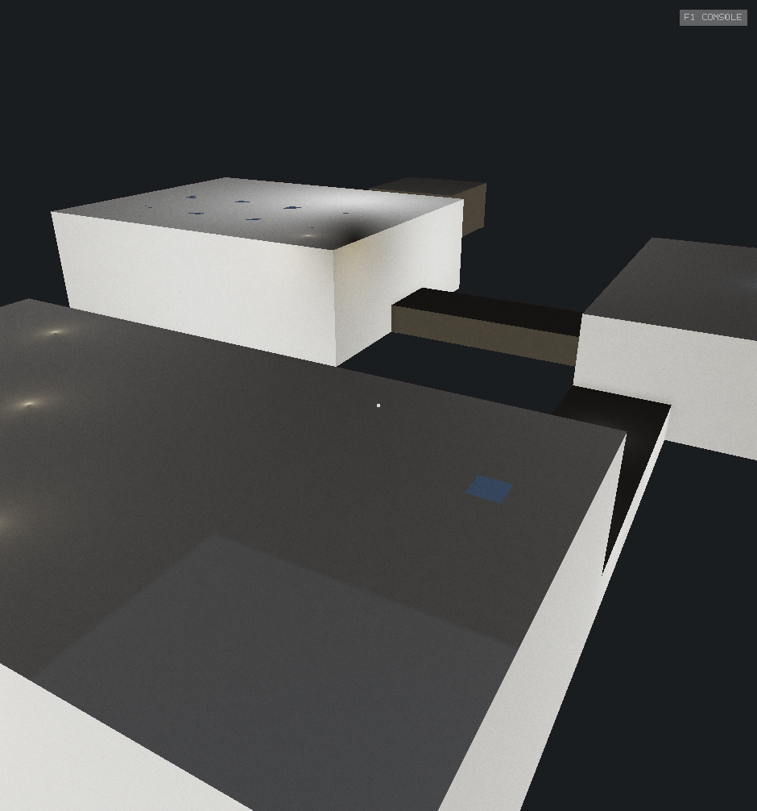
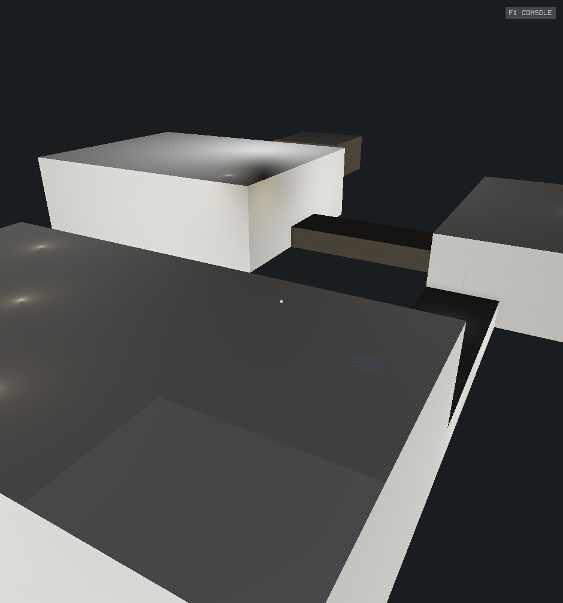

# soldatik3D


**soldatik3D** — a modular 3D game engine in Rust with two production-ready graphics backends: **Vulkan 1.2** and **OpenGL 3.3 core / ES 3.0**. The repository contains the engine and a demonstration game that uses only the public `runtime` API, completely agnostic to the underlying graphics API.

The engine is built from focused crates with single responsibilities: assets, scene & cameras, a dependency-free TrueType text engine, a hybrid immediate-mode UI, renderer abstraction, platform abstraction, two graphics backends, and a runtime facade. The demo lives outside `crates/`, keeping `crates/` as pure engine code.

<div align="center">
  <table>
    <tr>
      <td align="center"><strong>Vulkan Gameplay</strong></td>
      <td align="center"><strong>OpenGL Gameplay</strong></td>
    </tr>
    <tr>
      <td></td>
      <td></td>
    </tr>
    <tr>
      <td align="center"><strong>In-Game Console</strong></td>
      <td align="center"><strong>Debug Views</strong></td>
    </tr>
    <tr>
      <td></td>
      <td></td>
    </tr>
  </table>
</div>

---

## Features

- **Dual Graphics Backends** — Vulkan 1.2 (`ash` + `shaderc`) and OpenGL 3.3 core / ES 3.0 (`glutin` + `glow`). Switch via env var or `GameConfig`.
- **Controlled VSync** — `On`, `Off`, `Adaptive`, `Mailbox`; configurable via `GameConfig`, `SOLDATIK3D_VSYNC`, and console commands `vsync.*`. Defaults to `On`; use `SOLDATIK3D_VSYNC=off` for benchmarks.
- **Cross-Platform Builds** — Linux x86_64, Windows x86_64 (MSVC), Android (arm64-v8a / armeabi-v7a) built in GitHub Actions on every push and attached to every GitHub Release/prerelease.
- **Forward PBR Rendering** — Metallic/roughness workflow, IBL from procedural environment cubemap, up to 8 point lights.
- **Shadows** — Orthographic shadow map 2048² with PCF filtering.
- **Post-Processing** — Half-res SSAO, bright-pass bloom with separable Gaussian blur, ACES tone mapping and gamma correction. HDR pipeline uses `R16G16B16A16_SFLOAT`.
- **Frustum Culling** — Camera and light frustum culling for optimal draw calls.
- **Cameras as Engine Citizens** — `World` and `CameraRig` allow spawning named cameras, selecting active, cycling next/prev, and removing them. Runtime always renders through the active camera.
- **Built-In Developer Console** — Command registry, Tab completion, input history, hints, and extensible with game commands. Opens with `F1` or `` ` ``.
- **Hybrid Immediate-Mode UI** — `Ui` widgets called every frame over a retained arena tree: flexbox-style layout, buttons, labels, toggles, sliders, dropdowns, progress bars, scroll panels, touch-friendly joystick and touch camera. Embedded **Open Sans** (Latin + Cyrillic) rendered by the engine's own dependency-free TrueType rasterizer.
- **Screenshots & Diagnostics** — `F12` or `screenshot` command saves current frame as PNG; `SOLDATIK3D_VALIDATION=1` enables Vulkan validation layers.
- **Cross-Platform Window & Input** — Via `winit`, isolated in `platform` crate; backends receive only raw handles and surface size.
- **Demo Game** — Procedural level, 7 cameras, lighting, collisions, FPS controller, debug views.

---

## Repository Structure

```text
soldatik3D/
├── .cargo/
│   └── config.toml       # Build profiles; cross-linkers set in CI/scripts
├── .github/
│   └── workflows/
│       ├── ci.yml        # Linux + Windows + Android on every push/PR
│       └── release.yml   # Release builds + APK packaging
├── crates/
│   ├── assets/           # Textures, legacy bitmap font, environment cubemap
│   ├── scene/            # Camera, CameraRig, World, Mesh, Material, Light, Scene
│   ├── text/             # Dependency-free TTF parser, rasterizer, glyph atlas, layout
│   ├── ui/               # Hybrid immediate-mode Ui, widgets, layout, draw list
│   ├── render/           # Renderer, BackendKind, FrameData, WindowSurface
│   ├── platform/         # winit: window, input, raw handles, TargetOS
│   ├── vulkan/           # Vulkan backend, pipelines, GLSL shaders
│   ├── opengl/           # OpenGL backend, FBO pipeline, GLSL shaders
│   ├── runtime/          # Facade: Game trait, event loop, World, console, factory
│   └── s3d/              # CLI tool: project creation, building, exporting
├── examples/
│   └── demo/             # Demo game (package `demo`)
├── scripts/
│   ├── cross_build.sh    # Local Linux/Windows/Android builds
│   └── apk/              # build_apk.sh + Gradle template (CI source of truth)
├── templates/
│   └── game/             # Self-contained game project template (desktop + Android)
├── docs/                 # Full documentation (guides, API reference, examples)
├── Cargo.toml            # Workspace
└── LICENSE               # GPL-3.0
```

Dependency graph:

```text
examples/demo ──► runtime ──► scene ──► assets
                     │           ▲
                     ├─► ui ──► text
                     ├─► render  │
                     ├─► platform│
                     ├─► vulkan ─┘ (optional feature)
                     └─► opengl ── (optional feature)
```

`demo` depends only on `runtime` and `anyhow`. `vulkan` and `opengl` don't know about `winit` and receive `render::WindowSurface` with raw handles. Both backends implement one trait `render::Renderer`. Details in [`docs/ARCHITECTURE.md`](docs/ARCHITECTURE.md).

---

## Requirements

- **Rust stable** (edition 2024; CI uses `dtolnay/rust-toolchain@stable`).
- **Linux**: Vulkan loader + ICD, OpenGL 3.3 + EGL/GLX, X11/Wayland headers for `winit`/`glutin`.
- **Windows**: MSVC toolchain (Visual Studio Build Tools with C++), Vulkan driver, OpenGL 3.3 via WGL/EGL.
- **Android**: NDK r26c+, API 29+, OpenGL ES 3.0. Android builds use only OpenGL ES; Vulkan backend is not compiled for Android. Demo builds as `libdemo.so` — native-activity `cdylib` with `android_main`, not a standalone executable.
- For Vulkan backend on desktop, `shaderc` compiles GLSL at runtime: needs C++17 compiler, CMake, Python 3. On Linux, system `libshaderc` shared library is preferred (see [`docs/CI.md`](docs/CI.md)); Ubuntu's `libshaderc_combined.a` is incomplete and requires a workaround. Debug builds enable `VK_LAYER_KHRONOS_validation` if available.

macOS, iOS, and WebAssembly are **not supported**: platform branches removed from `platform`, CI builds only Linux, Windows, and Android.

Arch Linux quick install:

```bash
sudo pacman -S rust vulkan-icd-loader vulkan-validation-layers cmake python mesa
```

---

## Quick Start

```bash
git clone https://github.com/finesoldat1k/soldatik3D
cd soldatik3D

# Build engine and demo separately
cargo build --locked -p runtime --all-features
cargo build --locked -p demo --all-features

# Run demo (Vulkan by default)
cargo run -p demo

# Release build
cargo run --release -p demo
```

Same commands run in GitHub Actions for Linux, Windows, and Android on every push. Details in [`docs/CI.md`](docs/CI.md).

### Choose Graphics Backend

```bash
# Vulkan (default)
cargo run -p demo

# OpenGL
SOLDATIK3D_BACKEND=opengl cargo run -p demo

# In code
use runtime::{BackendKind, GameConfig};
let config = GameConfig::default().with_backend(BackendKind::OpenGl);
```

`runtime` enables both backends via features `vulkan` and `opengl` (both on by default). Disable unused backends when using as a dependency:

```toml
runtime = { path = "../soldatik3D/crates/runtime", default-features = false, features = ["opengl"] }
```

---

## s3d — Development Toolchain

The engine includes **`s3d`**, a built-in CLI tool for project management. It's compiled with the engine and included in release artifacts per platform — no separate installation needed.

```bash
# Create a new game project
s3d new my_game
cd my_game

# Run on desktop
cargo run

# Build for all platforms
s3d build all --release

# Build Android APK
s3d apk arm64-v8a --release

# Export distributable packages
s3d export --platforms linux,windows,android --out-dir dist

# Validate project configuration
s3d check android

# Show engine info
s3d info
```

### s3d Commands

| Command | Description |
|---------|-------------|
| `s3d new <name> [--dir <path>]` | Create a new game project from the template |
| `s3d build <linux\|windows\|android\|all> [--release]` | Build for platform(s) |
| `s3d run [linux\|windows] [--release]` | Run on desktop |
| `s3d apk <arm64-v8a\|armeabi-v7a\|x86_64> [--release]` | Build an Android APK |
| `s3d export [--platforms ...] [--out-dir dist]` | Build distributable artifacts |
| `s3d check [<platform>]` | Validate project configuration |
| `s3d info` | Show engine version and capabilities |
| `s3d engine version\|link\|update` | Engine management |

`s3d` is built with the engine and included in the Linux and Windows release
archives. It can also be built locally with `cargo build --release -p s3d`.

---

## API Overview

A game implements the `Game` trait. The engine owns the window, event loop,
renderer, input snapshot and developer console; the game owns its state, its
`World` and all gameplay logic.

```rust
use runtime::glam::Vec3;
use runtime::{
    run, Camera, CameraRig, Game, GameConfig, Light, Material, PrimaryLight, Scene,
    UpdateContext, World,
};

struct MyGame;

impl Game for MyGame {
    fn config(&self) -> GameConfig {
        GameConfig::default()
            .with_title("My Game")
            .with_size(1280, 720)
    }

    fn create_world(&mut self) -> World {
        let scene = Scene::new(Material::default())
            .with_primary_light(PrimaryLight::default())
            .with_lights(vec![
                Light::new(Vec3::new(3.0, 2.0, 3.0), Vec3::ONE, 10.0),
            ]);

        let mut cameras = CameraRig::empty();
        cameras.spawn("main", Camera::at(Vec3::new(0.0, 2.0, 5.0)));
        World::with_cameras(scene, cameras)
    }

    fn update(&mut self, ctx: &mut UpdateContext<'_>) {
        // ctx.dt, ctx.input, ctx.world, ctx.ui, ctx.stats, ctx.viewport
        if let Some(camera) = ctx.world.active_camera_mut() {
            camera.camera.position.x += ctx.dt;
        }
    }
}

fn main() -> anyhow::Result<()> {
    run(MyGame)
}
```

Android uses the same `Game`; the `cdylib` exports the native-activity entry
point:

```rust
#[cfg(target_os = "android")]
#[unsafe(no_mangle)]
pub fn android_main(app: runtime::winit::platform::android::activity::AndroidApp) {
    runtime::run_android(MyGame, app).expect("game failed");
}
```

### Core Types

| Type | Description |
|------|-------------|
| `Game` | Trait implemented by a game: `config`, `create_world`, `update`, optional `debug_view`, `input_map`, `command_help`, `command` |
| `GameConfig` | Window title, size, cursor lock, `BackendKind`, `VsyncMode` |
| `World` | Renderable `Scene` plus a `CameraRig`; the runtime renders through the active camera |
| `Scene` | Meshes, point lights, `PrimaryLight` (shadow caster), one `Material`, clear color. Uploaded once at startup |
| `Camera` / `CameraRig` | Position, yaw/pitch, FOV, near/far; named cameras with stable IDs and selection |
| `Mesh` / `Vertex` / `Aabb` | Custom world-space geometry and bounds |
| `Material` / `TextureData` | Albedo texture, metallic, roughness (one material per scene) |
| `Light` / `PrimaryLight` | Up to 8 nearest local point lights; one directional shadow-casting light |
| `Input` / `InputMap` | Keyboard and mouse state plus named action bindings |
| `Ui` | Hybrid immediate-mode widgets, flex layout, theming, raw text/rectangles, crosshair |
| `TextSystem` | TTF parsing, rasterization, layout and the dynamic R8 glyph atlas (`text` crate) |
| `CommandContext` | Game-defined console command name, arguments and world access |
| `BackendKind` / `VsyncMode` / `DebugView` | Backend selection, swapchain pacing, debug visualization |
| `RenderStats` | Vertices, triangles and draw calls of the previous frame |

---

## Demo Controls

| Key | Action |
|-----|--------|
| `WASD` | Move |
| `Shift` | Sprint |
| `Space` | Jump / Fly up |
| `Ctrl` | Fly down |
| `F` | Toggle flight mode |
| Mouse | Look around |
| `Tab` | Release/grab cursor (completion in console) |
| `F1` / `` ` `` | Toggle console |
| `Enter` | Execute command |
| `↑` / `↓` | Command history |
| `F12` | Screenshot (engine-level) |
| `Esc` | Close console / release cursor / exit |
| `F2` / `F3` / `F4` | Lit / Normals / Depth |

---

## Console Commands

Built-in commands (type `help` in console):

| Command | Description |
|---------|-------------|
| `help` | List all commands |
| `clear` | Clear console |
| `quit` / `exit` | Exit game |
| `backend` | Show current backend (`SOLDATIK3D_BACKEND` selects it at startup) |
| `vsync.on` / `vsync.off` / `vsync.adaptive` / `vsync.mailbox` | Set VSync mode |
| `vsync.toggle` | Toggle VSync on/off |
| `vsync.current` | Show current VSync |
| `screenshot` | Save a PNG through the active backend |
| `camera.list` | List cameras |
| `camera.select <name\|id>` | Switch camera |
| `camera.next` / `camera.prev` | Cycle cameras |
| `camera.spawn <name> [x y z] [yaw] [pitch]` | Create camera |
| `camera.remove <name\|id>` | Delete camera (the last one cannot be removed) |
| `camera.rename <name>` | Rename active camera |
| `camera.info` | Show active camera details |
| `camera.set <x y z> [yaw] [pitch]` | Move active camera |

Add game commands by overriding `command_help` and `command`:

```rust
use runtime::{CommandContext, Game};

impl Game for MyGame {
    // ... config, create_world, update ...

    fn command_help(&self) -> &'static [(&'static str, &'static str)] {
        &[("teleport", "teleport <x> <y> <z>")]
    }

    fn command(&mut self, ctx: &mut CommandContext<'_>) -> Option<Result<String, String>> {
        match ctx.name {
            "teleport" => {
                if ctx.args.len() != 3 {
                    return Some(Err("usage: teleport <x> <y> <z>".into()));
                }
                let mut position = [0.0_f32; 3];
                for (slot, value) in position.iter_mut().zip(ctx.args) {
                    *slot = match value.parse() {
                        Ok(value) => value,
                        Err(_) => return Some(Err("invalid coordinate".into())),
                    };
                }
                if let Some(camera) = ctx.world.active_camera_mut() {
                    camera.camera.position = runtime::glam::Vec3::from(position);
                }
                Some(Ok("teleported".into()))
            }
            _ => None,
        }
    }
}
```

Game command descriptions are shown by `help`; the engine handles built-in
commands first.

---

## Environment Variables

| Variable | Values | Default | Description |
|----------|--------|---------|-------------|
| `SOLDATIK3D_BACKEND` | `vulkan`/`vk`, `opengl`/`gl` | platform default | Force graphics backend |
| `SOLDATIK3D_VSYNC` | `on`, `off`, `adaptive`, `mailbox` | `on` | VSync mode |
| `SOLDATIK3D_MAX_FRAMES` | `<u64>` | none | Auto-exit after N frames |
| `SOLDATIK3D_COMMANDS` | `"cmd1;cmd2"` | `""` | Startup console commands |
| `SOLDATIK3D_CONSOLE` | `1`, `true`, `yes`, `on` | off | Open console at startup |
| `SOLDATIK3D_VALIDATION` | `1`, `true`, `yes`, `on` | on in debug builds | Request Vulkan validation layers |
| `SOLDATIK3D_DEBUG_VIEW` | `lit`, `normals`, `depth` | `lit` | Demo-only initial debug view |

---

## Building & Distribution

### Local Development

```bash
# Debug
cargo run -p demo

# Release
cargo build --release -p demo

# Run with specific backend
SOLDATIK3D_BACKEND=opengl cargo run -p demo

# Benchmark (no VSync, auto-exit)
SOLDATIK3D_VSYNC=off SOLDATIK3D_MAX_FRAMES=100 cargo run --release -p demo
```

### Cross-Compilation

```bash
# Windows from Linux (MinGW, OpenGL only)
./scripts/cross_build.sh windows --release

# Android (requires NDK)
export ANDROID_NDK_HOME=$HOME/android-ndk-r26c
./scripts/cross_build.sh android arm64-v8a --release
./scripts/cross_build.sh android armeabi-v7a --release

# All platforms
./scripts/cross_build.sh all --release
```

### Android APK

```bash
export ANDROID_NDK_HOME=$HOME/android-ndk-r26c
export ANDROID_SDK_ROOT=$HOME/Android/Sdk

# Engine demo APK (scripts/apk/gradle is the source of truth used by CI)
./scripts/apk/build_apk.sh arm64-v8a
./scripts/apk/build_apk.sh arm64-v8a --release

# From a generated game project, the script is at the project root:
./build_apk.sh arm64-v8a --release
# or:
s3d apk arm64-v8a --release
```

### Export Artifacts

```bash
s3d export --platforms linux,windows,android --out-dir dist
# Writes binaries/libraries directly into dist/:
#   dist/my_game                 (Linux executable)
#   dist/my_game.exe             (Windows, requires MinGW)
#   dist/libmy_game-arm64-v8a.so (Android)
#   dist/libmy_game-armeabi-v7a.so
```

`s3d export` always builds in release mode. Windows and Android exports require
the corresponding cross toolchains. For a relocatable Linux bundle with
`libshaderc.so.1` and `libvulkan.so.1`, use
`./scripts/cross_build.sh linux --release`, which writes
`dist/linux-x86_64/`.

### GitHub Actions CI/CD

- **CI** (`.github/workflows/ci.yml`): Runs on every push/PR — Linux, Windows, Android builds, clippy, tests, rustdoc, and a debug APK per Android ABI.
- **Release** (`.github/workflows/release.yml`): Triggers on GitHub Release publish, including prereleases — builds release artifacts for all platforms, builds release APKs, and attaches engine, demo, CLI toolkit and APK files to the release.

The `soldatik3d-cli-*` archive contains `bin/s3d`, `templates/game`, the engine
`crates/`, `examples/demo` and the workspace manifest. Keep it extracted as a
directory: generated projects point their `runtime` dependency at its
`crates/runtime`.

Create a release:

```bash
git tag v0.1.0
git push origin v0.1.0
# Then create GitHub Release from the tag (can mark as pre-release)
```

---

## Documentation

Full documentation in [`docs/`](docs/):

| Section | Files |
|---------|-------|
| **Getting Started** | [Quick Start](docs/getting-started/quick-start.md) • [Installation](docs/getting-started/installation.md) • [Project Structure](docs/getting-started/project-structure.md) • [First Game Tutorial](docs/getting-started/first-game.md) |
| **Guides** | [Architecture](docs/guides/architecture.md) • [Game Loop](docs/guides/game-loop.md) • [Linux](docs/guides/linux.md) • [Windows](docs/guides/windows.md) • [Android](docs/guides/android.md) • [Cross-Compilation](docs/guides/cross-compilation.md) |
| **API Reference** | [Runtime](docs/api/runtime.md) • [Rendering](docs/api/rendering.md) • [Scene](docs/api/scene.md) • [Input](docs/api/input.md) • [UI/Console](docs/api/ui.md) • [Assets](docs/api/assets.md) • [Platform](docs/api/platform.md) |
| **Examples** | [Basic](docs/examples/basic.md) • [Advanced](docs/examples/advanced.md) • [Platform-Specific](docs/examples/platform-specific.md) |
| **Reference** | [CLI](docs/reference/cli.md) • [Console Commands](docs/reference/cli-commands.md) • [Configuration](docs/reference/configuration.md) • [Changelog](docs/reference/changelog.md) • [Migration](docs/reference/migration.md) |
| **Project** | [Architecture](docs/ARCHITECTURE.md) • [CI and Releases](docs/CI.md) • [Contributing](CONTRIBUTING.md) |

---

## Known Limitations and Future Work

Current limitations, documented so they are not mistaken for features:

- No audio, physics, animation, networking or scripting.
- No gamepad or touch input API.
- No runtime mesh, material or texture updates; the scene is uploaded once.
- No asset manager, virtual filesystem or hot reload.
- One material per scene, one shadow-casting light, eight point lights.
- Release APKs are debug-signed unless `SOLDATIK3D_KEYSTORE*` is configured.
- `s3d engine update`, `s3d engine link` and `s3d apk --sign` are placeholders.

Planned work, in no particular order: dynamic geometry and multi-material
scenes, an asset manager, audio, physics, animation, gamepad/touch input and
stronger release signing defaults.

**macOS, iOS, WebAssembly and consoles are not supported and are not planned.**

---

## Contributing

1. Fork the repository
2. Create a feature branch
3. Make your changes
4. Run `cargo fmt --all && cargo clippy --workspace --all-targets --all-features && cargo test --workspace --all-features`
5. Submit a PR

See [`CONTRIBUTING.md`](CONTRIBUTING.md) for detailed guidelines.

---

## License

**GNU General Public License v3.0 (GPLv3)** — see [LICENSE](LICENSE) for details.

---

## Community

- **Issues**: [GitHub Issues](https://github.com/finesoldat1k/soldatik3D/issues) — bugs, feature requests
- **Discussions**: [GitHub Discussions](https://github.com/finesoldat1k/soldatik3D/discussions) — questions, ideas, showcase
- **Wiki**: [GitHub Wiki](https://github.com/finesoldat1k/soldatik3D/wiki) — community guides

---

*Built with ❤️ in Rust. Soldatik3D — your game, your rules.*