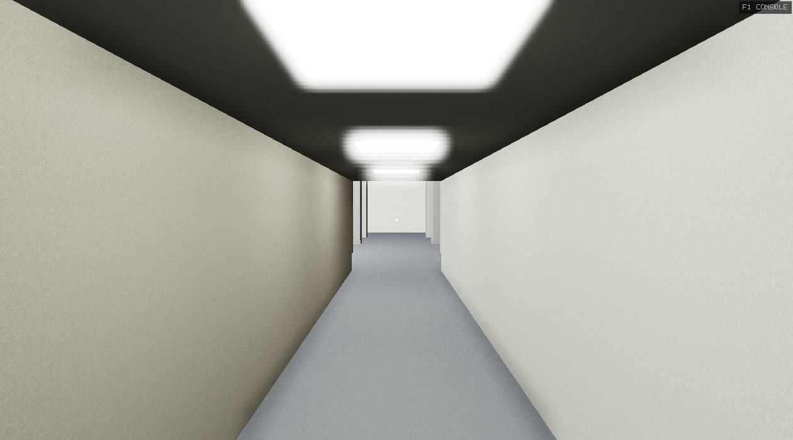

# soldatik3D


**soldatik3D** — модульный игровой движок на Rust с двумя полноценными
графическими бэкендами: Vulkan 1.2 и OpenGL 3.3 core. Репозиторий содержит
сам движок и демонстрационную игру, которая использует только публичный API
`runtime` и не знает, какой графический API выбран.

Движок собран из небольших крейтов с одной ответственностью: ассеты, сцена и
камеры, UI, контракт рендерера, платформа, два бэкенда и рантайм-фасад.
Демо лежит вне `crates/`, поэтому каталог `crates/` содержит только код
движка.



---

## Возможности

- **Два бэкенда с одинаковым результатом**: Vulkan 1.2 (`ash` + `shaderc`) и
  OpenGL 3.3 core (`glutin` + `glow`). Переключение одной переменной окружения
  или одним полем `GameConfig`.
- **Управляемый VSync**: `On`, `Off`, `Adaptive`, `Mailbox`; настраивается через
  `GameConfig`, `SOLDATIK3D_VSYNC` и команды консоли `vsync.*`. По умолчанию
  включён `On`; для бенчмарков используйте `SOLDATIK3D_VSYNC=off`.
- **Кроссплатформенная сборка**: Linux x86_64, Windows x86_64 (MSVC) и Android
  (arm64-v8a / armeabi-v7a) собираются в GitHub Actions на каждый push и
  прикрепляются к каждому GitHub Release/prerelease.
- **Forward PBR-рендеринг**: metallic/roughness, IBL из процедурного
  environment cubemap, до восьми точечных источников света.
- **Тени**: ортографическая shadow map 2048² с фильтрацией.
- **Постобработка**: SSAO половинного разрешения, bright-pass bloom с
  разделяемым гауссовым блюром, ACES tone mapping и гамма-коррекция.
  HDR-пайплайн использует `R16G16B16A16_SFLOAT`.
- **Отсечение по пирамиде видимости** для камеры и источника тени.
- **Камеры как часть движка**: `World` и `CameraRig` позволяют спавнить
  именованные камеры, выбирать активную, переключать следующую/предыдущую и
  удалять их. Рантайм всегда рендерит через активную камеру.
- **Встроенная консоль**: реестр команд, автодополнение по `Tab`, история
  ввода, подсказки и расширение командами игры. Открывается по `F1` или `` ` ``.
- **Immediate-mode UI** со встроенным bitmap-шрифтом: заглавные и строчные
  `a-z`, цифры, пунктуация, панели, кнопки, статус и перекрестие.
- **Скриншоты и диагностика**: `F12` или команда `screenshot` сохраняет кадр в
  PNG; `SOLDATIK3D_VALIDATION=1` включает Vulkan validation layers.
- **Кроссплатформенное окно и ввод** через `winit`, изолированные в
  `platform`; бэкенды получают только raw handles и размер поверхности.
- **Демо-игра** с процедурным уровнем, семью камерами, освещением,
  коллизиями, FPS-контроллером и debug-видами.

---

## Структура репозитория

```text
soldatik3D/
├── .cargo/
│   └── config.toml   # профили сборки; кросс-линкеры задаются в CI/скрипте
├── .github/
│   └── workflows/
│       ├── ci.yml    # Linux + Windows + Android на каждый push/PR
│       └── release.yml
├── crates/
│   ├── assets/       # текстуры, bitmap-шрифт, environment cubemap
│   ├── scene/        # Camera, CameraRig, World, Mesh, Material, Light, Scene
│   ├── ui/           # UiDrawList и UiVertex для immediate-mode UI
│   ├── render/       # Renderer, BackendKind, FrameData, WindowSurface
│   ├── platform/     # winit: окно, ввод, raw handles, TargetOS
│   ├── vulkan/       # Vulkan-бэкенд, пайплайны и GLSL-шейдеры
│   ├── opengl/       # OpenGL-бэкенд, FBO-пайплайн и GLSL-шейдеры
│   └── runtime/      # фасад: Game trait, event loop, World, консоль, фабрика
├── examples/
│   └── demo/         # демонстрационная игра (package `demo`)
├── docs/
│   ├── ARCHITECTURE.md
│   ├── CI.md         # сборка, кросс-компиляция и GitHub Actions
│   ├── screenshot.jpg
│   └── console.jpg
├── cross_build.sh    # локальная сборка Linux/Windows/Android
└── Cargo.toml        # workspace
```

Граф зависимостей:

```text
examples/demo ──► runtime ──► scene ──► assets
                     │           ▲
                     ├─► ui ─────┤
                     ├─► render  │
                     ├─► platform│
                     ├─► vulkan ─┘ (optional feature)
                     └─► opengl ── (optional feature)
```

`demo` зависит только от `runtime` и `anyhow`. `vulkan` и `opengl` не знают о
`winit` и получают `render::WindowSurface` с raw handles. Оба бэкенда
реализуют один трейт `render::Renderer`. Подробности —
в [`docs/ARCHITECTURE.md`](docs/ARCHITECTURE.md).

---

## Требования

- **Rust stable** (edition 2024; в CI используется `dtolnay/rust-toolchain@stable`).
- **Linux**: Vulkan loader + ICD, OpenGL 3.3 и EGL/GLX, заголовки X11/Wayland
  для `winit`/`glutin`.
- **Windows**: toolchain MSVC (Visual Studio Build Tools с C++), драйвер
  Vulkan, OpenGL 3.3 через WGL/EGL.
- **Android**: NDK r26c (или новее), API 29+, OpenGL ES 3.0. Android-сборка
  использует только OpenGL ES; Vulkan-бэкенд в неё не компилируется. Демо
  собирается как `libdemo.so` — native-activity `cdylib` с `android_main`, а
  не как отдельный исполняемый файл.
- Для Vulkan-бэкенда на desktop `shaderc` компилирует GLSL во время запуска:
  нужны C++17-компилятор, CMake и Python 3. На Linux можно использовать
  системную shared-библиотеку `libshaderc` (см.
  [`docs/CI.md`](docs/CI.md)); встроенная сборка `libshaderc_combined.a` из
  Ubuntu 24.04 не линкуется без дополнительной настройки. В debug-сборках
  подключается `VK_LAYER_KHRONOS_validation`, если слой установлен.

macOS, iOS и WebAssembly не поддерживаются: платформенные ветки для них
удалены из `platform`, а CI собирает только Linux, Windows и Android.

Arch Linux:

```bash
sudo pacman -S rust vulkan-icd-loader vulkan-validation-layers cmake python mesa
```

---

## Быстрый старт

```bash
git clone https://github.com/finesoldat1k/soldatik3D
cd soldatik3D

# движок и игра собираются отдельно
cargo build --locked -p runtime --all-features
cargo build --locked -p demo --all-features

# debug-запуск, оба бэкенда включены
cargo run -p demo

# release-сборка
cargo run --release -p demo
```

Те же команды выполняются в GitHub Actions для Linux, Windows и Android на
каждый push; подробности — в [`docs/CI.md`](docs/CI.md).

### Выбор графического бэкенда

По умолчанию используется Vulkan. Бэкенд можно выбрать переменной окружения:

```bash
SOLDATIK3D_BACKEND=vulkan cargo run -p demo
SOLDATIK3D_BACKEND=opengl cargo run -p demo
```

Или в коде игры:

```rust
use runtime::{BackendKind, GameConfig};

let config = GameConfig::default().with_backend(BackendKind::OpenGl);
```

`runtime` включает оба бэкенда через features `vulkan` и `opengl` (обе
включены по умолчанию). Если движок используется как зависимость, ненужные
бэкенды отключаются в манифесте:

```toml
runtime = { path = "../soldatik3D/crates/runtime", default-features = false, features = ["opengl"] }
```

Выбранный, но не скомпилированный бэкенд даёт понятную ошибку при запуске.

---

## API движка

Игра реализует `Game`, создаёт `World` и получает его каждый кадр. Камеры
спавнятся и выбираются через движок; рендер, ввод, окно и консоль остаются
внутри `runtime`.

```rust
use runtime::{glam::Vec3, run, Camera, CameraRig, Game, GameConfig, Scene, UpdateContext, World};

struct MyGame;

impl Game for MyGame {
    fn config(&self) -> GameConfig {
        GameConfig::default().with_title("My game")
    }

    fn create_world(&mut self) -> World {
        let scene = Scene::new(Default::default());
        let mut cameras = CameraRig::empty();
        cameras.spawn("player", Camera::at(Vec3::new(0.0, 2.0, 8.0)));
        cameras.spawn("overview", Camera::at(Vec3::new(20.0, 25.0, 30.0)));
        World::with_cameras(scene, cameras)
    }

    fn update(&mut self, ctx: &mut UpdateContext<'_>) {
        // ctx.world.active_camera() / active_camera_mut()
        // ctx.world.spawn_camera(...), select_camera(...), select_next_camera()
    }
}

fn main() -> anyhow::Result<()> {
    run(MyGame)
}
```

`UpdateContext` также содержит `dt`, `input`, `ui`, `stats`, `viewport` и
`console_open`. Для собственных команд игра реализует `Game::command` и
`Game::command_help`.

### Камеры и консоль

| Команда | Действие |
| --- | --- |
| `camera.list` | список камер с ID, именами и позициями |
| `camera.select <name\|id>` | сделать камеру активной (`overview`, `cam-6`, `6`) |
| `camera.next` / `camera.prev` | переключить камеру по кругу |
| `camera.spawn <name> [x y z] [yaw] [pitch]` | создать камеру |
| `camera.remove <name\|id>` | удалить камеру (кроме последней) |
| `camera.rename <name>` | переименовать активную камеру |
| `camera.info` | позиция, углы, FOV и диапазон активной камеры |
| `camera.set x y z [yaw] [pitch]` | переместить активную камеру |
| `help`, `clear`, `quit`, `backend` | справка, очистка, выход, текущий бэкенд |

Демо добавляет команды `debug.lit`, `debug.normals`, `debug.depth`,
`debug.cycle`, `player.camera`, `player.teleport`, `player.fly` и
`player.reset`.


---

## Управление в демо

| Клавиши | Действие |
| --- | --- |
| `WASD` | движение |
| `Shift` | бег |
| `Space` | прыжок, в полёте — вверх |
| `Ctrl` | вниз в режиме полёта |
| `F` | включить/выключить полёт |
| `Мышь` | обзор |
| `Tab` | освободить/захватить курсор; в открытой консоли — автодополнение |
| `F1` / `` ` `` | открыть/закрыть консоль |
| `Enter` | выполнить команду |
| `↑` / `↓` | история команд |
| `F12` | сохранить скриншот в PNG |
| `Esc` | закрыть консоль, освободить курсор или выйти |
| `F2` / `F3` / `F4` | lit / normals / depth |

Игрок управляет камерой `player`, только когда она активна. Через консоль
можно переключиться на пресеты `corridor`, `left-hall`, `right-hall`, `pool`,
`final-hall` и `overview`.

---

## Переменные окружения

| Переменная | Назначение |
| --- | --- |
| `SOLDATIK3D_BACKEND=vulkan\|opengl` | выбрать графический бэкенд |
| `SOLDATIK3D_VSYNC=on\|off\|adaptive\|mailbox` | режим вертикальной синхронизации |
| `SOLDATIK3D_MAX_FRAMES=<n>` | отрендерить `n` кадров и корректно завершиться |
| `SOLDATIK3D_COMMANDS="cmd1;cmd2"` | выполнить команды консоли после старта |
| `SOLDATIK3D_CONSOLE=1` | открыть консоль при старте |
| `SOLDATIK3D_DEBUG_VIEW=normals\|depth` | стартовый debug-вид демо |
| `SOLDATIK3D_VALIDATION=1` | включить Vulkan validation layers |

По умолчанию VSync включён (`On`). Для замера максимального FPS:

```bash
SOLDATIK3D_VSYNC=off cargo run --release -p demo
```

Режим можно переключать на ходу командами `vsync.on`, `vsync.off`,
`vsync.adaptive`, `vsync.mailbox`, `vsync.toggle` и `vsync.current`.

Пример автоматической проверки камер и консоли:

```bash
SOLDATIK3D_BACKEND=opengl \
SOLDATIK3D_CONSOLE=1 \
SOLDATIK3D_COMMANDS="camera.list;camera.select overview;camera.info" \
SOLDATIK3D_MAX_FRAMES=60 \
cargo run -p demo
```

---

## Разработка

```bash
cargo fmt --all
cargo clippy --workspace --all-targets --all-features
cargo build -p runtime --all-features
cargo build -p demo --all-features
cargo test --workspace --all-features
cargo doc --workspace --no-deps --all-features --open
```

Smoke-тест обоих бэкендов без ручного закрытия окна:

```bash
SOLDATIK3D_BACKEND=vulkan SOLDATIK3D_MAX_FRAMES=3 cargo run -p demo
SOLDATIK3D_BACKEND=opengl SOLDATIK3D_MAX_FRAMES=3 cargo run -p demo
```

Локальная кросс-сборка:

```bash
./cross_build.sh linux
./cross_build.sh windows          # MinGW-w64, только OpenGL
ANDROID_NDK_HOME=~/android-ndk-r26c ./cross_build.sh android arm64-v8a
```

Android-демо — это `libdemo.so`, а не самостоятельный бинарник. Для запуска
нужен APK-хост с activity `android.app.NativeActivity`, `android:hasCode="false"`,
файлом `lib/<abi>/libdemo.so` и meta-data `android.app.lib_name="demo"`.
Подробности — в [`docs/CI.md`](docs/CI.md).

GitHub Actions запускает `CI` на каждый push/PR и `Release` при публикации
GitHub Release, включая prerelease. Полное описание job'ов, артефактов и
требований к NDK — в [`docs/CI.md`](docs/CI.md).

Шейдеры Vulkan компилируются `shaderc` при запуске из `crates/vulkan/shaders/`.
OpenGL-шейдеры лежат в `crates/opengl/shaders/` и также встроены в бинарник.

---

## Лицензия

Проект распространяется под лицензией **GNU General Public License v3.0
(GPLv3)**. Подробности — в файле [LICENSE](LICENSE).
